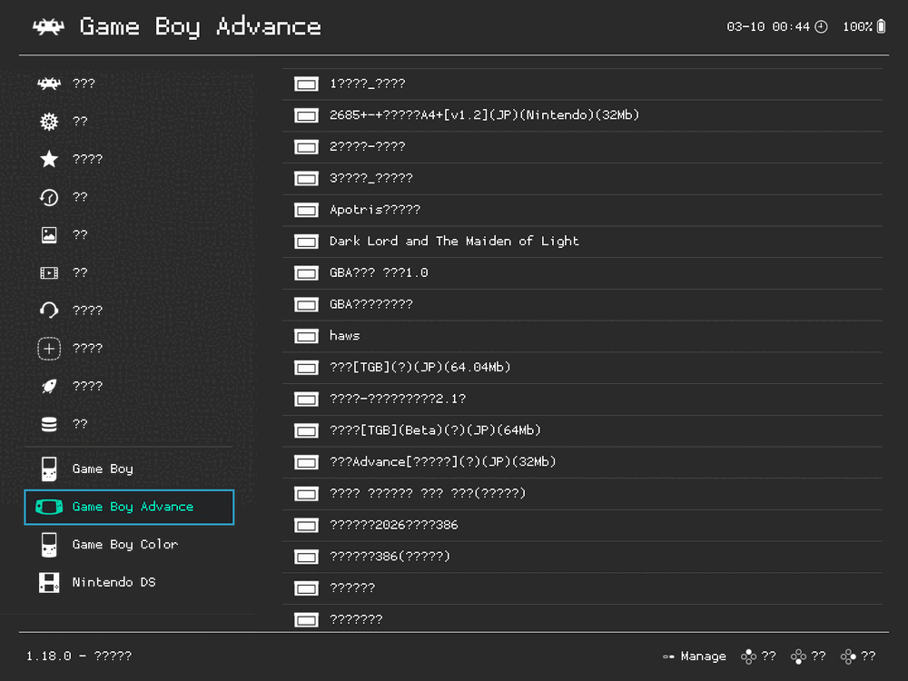
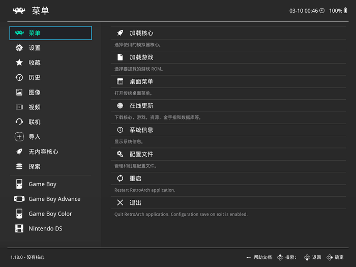
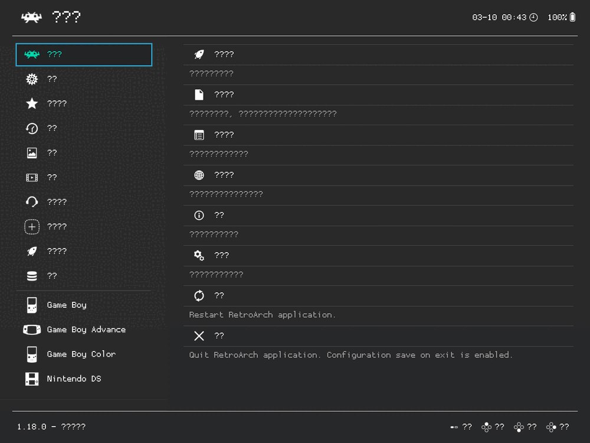
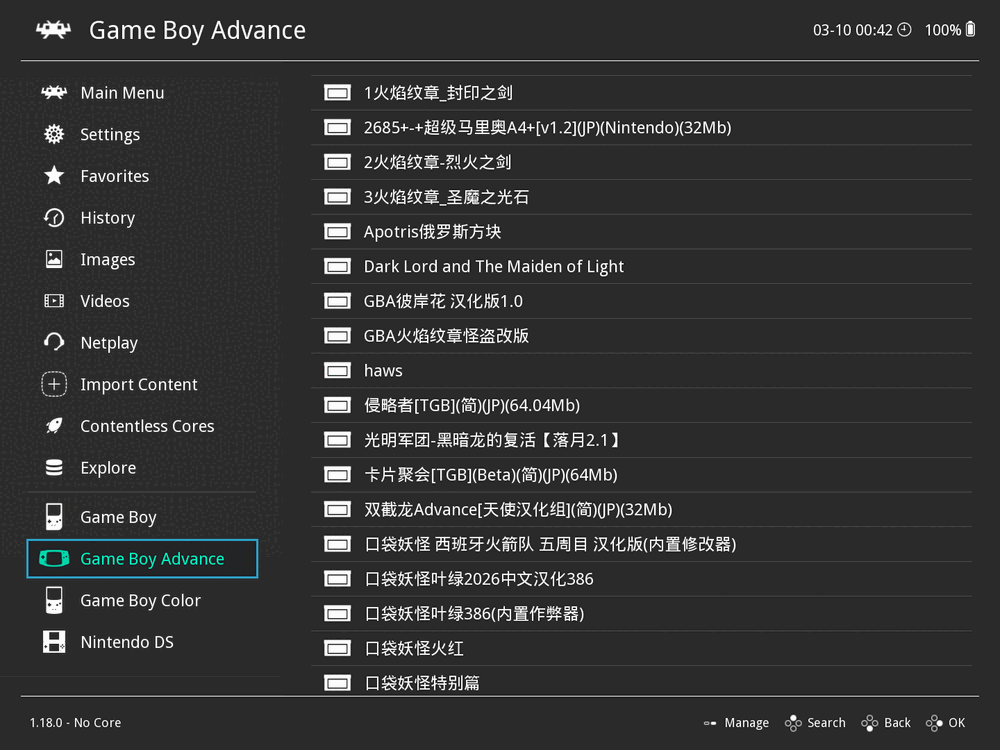
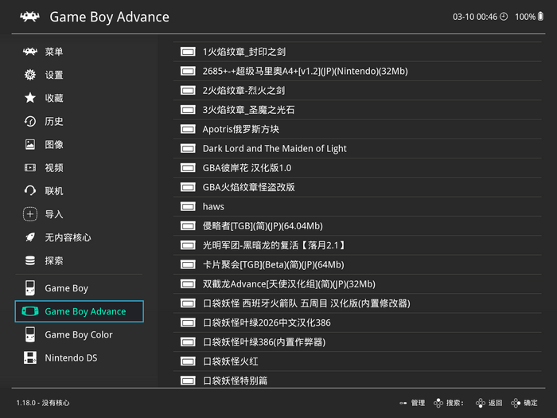
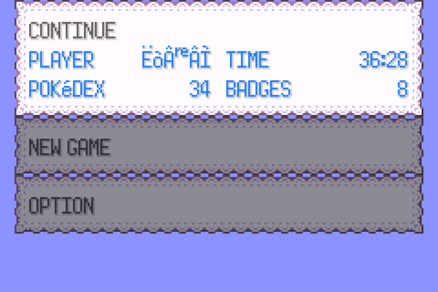

# RetroArch renders Chinese as `?`

**English** · **[中文](README.zh-CN.md)**

RetroArch's interface is completely unreadable in Chinese — and in several other
non-Latin languages. Every CJK character becomes `?`, while the Latin text in the
very same menu renders perfectly.

The fonts are fine. The problem is a **filename mismatch** between two
Debian/Ubuntu packages.

<table>
<tr>
<td width="50%"></td>
<td width="50%"></td>
</tr>
<tr>
<td align="center"><sub><b>Before</b> — every label and every Chinese ROM filename is <code>?</code></sub></td>
<td align="center"><sub><b>After</b> — the two-line fix below</sub></td>
</tr>
</table>

## The fix

```bash
retroarch        looks for  assets/pkg/chinese-fallback-font.ttf
retroarch-assets installs   assets/pkg/chinese-font.ttf
                                        ↑ missing "-fallback"
```

No file at the expected path → no CJK fallback font is loaded → FreeType
substitutes `?` for every character the primary Latin UI font doesn't have.

Two lines, nothing to reinstall:

```bash
sudo apt install fonts-droid-fallback
sudo ln -sf ../../../fonts/truetype/droid/DroidSansFallbackFull.ttf \
       /usr/share/libretro/assets/pkg/chinese-fallback-font.ttf
```

Or run the script, which checks, repairs, and **re-verifies**:

```bash
sudo ./tools/fix-cjk-font.sh          # add --check to only inspect
```

Then restart RetroArch. To switch the UI to Chinese, set `user_language = "12"`
in `~/.config/retroarch/retroarch.cfg` (**12 = Simplified, 11 = Traditional**).

## Why it's so hard to diagnose

Two things make this bug actively misleading:

- **English works perfectly.** The UI looks healthy right up until the moment you
  change the language, so nothing appears broken beforehand.
- **It looks exactly like a font-coverage problem.** It isn't.

Here's the wrong turn, and it's an expensive one — replacing the UI font with a
complete Noto Sans CJK (44,810 glyphs) changes nothing:

<table>
<tr>
<td width="50%"></td>
<td width="50%"></td>
</tr>
<tr>
<td align="center"><sub><b>The wrong turn.</b> Full Noto Sans CJK installed — still every character is <code>?</code>. Font coverage is not the problem.</sub></td>
<td align="center"><sub><b>The clue that cracks it.</b> Switch back to English, keep the same fonts — the Chinese ROM names render perfectly.</sub></td>
</tr>
</table>

The right-hand screenshot is the one that breaks it open. Same font, same menu,
same pixels: the font is proven good, the render path is proven good, the file
path is proven good. **The only remaining variable is the language setting
itself** — which sends you looking at what the language switch *loads*, not at
what the text *needs*.

## What's in here

| | |
|---|---|
| **[docs/tutorial-zh.html](docs/tutorial-zh.html)** | 中文图文教程 — 完整排查过程。单文件，下载后双击即可打开（字体和图都内嵌了）。 |
| [docs/bug-report.en.md](docs/bug-report.en.md) | Ready-to-submit bug report for Debian BTS / Launchpad |
| [tools/fix-cjk-font.sh](tools/fix-cjk-font.sh) | Checks, repairs, re-verifies. `--check` is read-only. |
| [tools/launch-portable-retroarch.sh](tools/launch-portable-retroarch.sh) | Portable install launcher with the font self-repair built in |
| [docs/shots/](docs/shots/) | All screenshots |

### Proof it actually works

<table>
<tr>
<td width="50%"></td>
<td width="50%"></td>
</tr>
<tr>
<td align="center"><sub>Chinese ROM titles in the playlist</sub></td>
<td align="center"><sub>And the save still loads — Pokédex 34, 8 badges, 36:28 played</sub></td>
</tr>
</table>

## Scope

This repo is **not** a RetroArch distribution. It's one bug, its diagnosis, and
the fix. No binaries; the only font content is the subset embedded in the
tutorial page.

Affects `retroarch-assets` `1.7.6+git20230911+dfsg-1` (Ubuntu 24.04 noble, and
presumably Debian testing/unstable) with `retroarch` `1.18.0+dfsg-1`. The same
package also ships a `korean-fallback-font.ttf` symlinked to a **Latin** font
with no Hangul at all, and omits the Thai and Ethiopic fallbacks entirely.

## Help wanted

This bug hasn't been reported upstream yet. If you file it on the Debian BTS or
Launchpad, open an issue here and I'll link it. The report is ready to paste:
[docs/bug-report.en.md](docs/bug-report.en.md).

## License

Scripts and text: MIT (see [LICENSE](LICENSE)).

The tutorial page embeds subset fonts — Noto Sans CJK SC (SIL OFL 1.1) and
DejaVu Sans Mono (Bitstream Vera). Full license texts in
[licenses/](licenses/).
